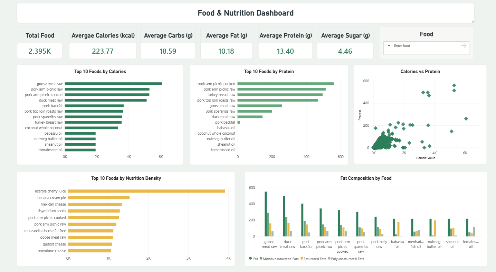

# Food Nutrition Analysis

## Project Overview

Food Nutrition Analysis is an exploratory data analysis and visualization project focused on understanding the nutritional characteristics of different food items.

The project analyzes nutritional attributes such as calories, carbohydrates, fats, sugars, protein, dietary fiber, cholesterol, sodium, and other nutrients. Statistical analysis, data visualization, correlation analysis, outlier detection, and feature engineering are used to identify patterns and relationships within the dataset.

A Power BI dashboard was also created to present the major nutritional metrics and comparisons interactively.

---

## Objectives

- Understand the nutritional composition of different food items.
- Analyze calorie, protein, fat, carbohydrate, and sugar distributions.
- Identify foods with high calorie, protein, and fiber values.
- Analyze relationships between nutritional attributes.
- Study correlations between nutrients.
- Detect outliers and skewed distributions.
- Create additional nutrition-related features.
- Build an interactive Power BI dashboard for nutritional analysis.

---

## Analysis Performed

### 1. Dataset Overview
- Dataset shape
- Column names
- Data types
- Dataset structure

### 2. Data Quality Analysis
- Missing value analysis
- Duplicate value detection
- Data consistency checks

### 3. Descriptive Statistics
- Mean
- Median
- Minimum and maximum values
- Standard deviation
- Statistical summary of nutritional attributes

### 4. Distribution Analysis
- Calorie distribution
- Fat distribution
- Sugar distribution
- Protein distribution
- Skewness analysis

### 5. Nutritional Analysis
- Macronutrient analysis
- Calorie analysis
- Protein analysis
- Fat analysis
- Carbohydrate analysis
- Sugar analysis
- Dietary fiber analysis

### 6. Relationship Analysis
- Fat vs Sugar
- Protein vs Calories
- Nutritional correlations
- Correlation heatmap
- Multivariate nutritional relationships

### 7. Outlier & Skewness Analysis
- IQR-based outlier detection
- Box plots
- Distribution analysis
- Skewness measurement

### 8. Statistical & Nutritional Analysis
- Top 10 foods by calories
- Top 10 foods by protein
- Top 10 foods by dietary fiber
- Macronutrient comparison
- Macronutrient relationship analysis
- Calorie distribution analysis
- Protein-per-calorie analysis

### 9. Feature Engineering

A derived feature called `Protein_per_Calorie` was created to analyze the amount of protein relative to the caloric value of a food item.

---

## Power BI Dashboard

The project includes an interactive Power BI dashboard containing:

- Total Food
- Average Calories
- Average Carbohydrates
- Average Fat
- Average Protein
- Average Sugar
- Top 10 Foods by Calories
- Top 10 Foods by Protein
- Calories vs Protein
- Top 10 Foods by Nutrition Density
- Fat Composition by Food
- Food slicer for interactive filtering

### Dashboard Preview



---

## Project Structure

```text
food-nutrition-analysis/
│
├── data/
│   └── Food.csv
│
├── notebooks/
│   └── 01_Food_Nutrition_EDA.ipynb
│
├── dashboard/
│   └── Food_Nutrition_Dashboard.pbix
│
├── images/
│   └── dashboard.png
│
├── README.md
├── requirements.txt
└── .gitignore